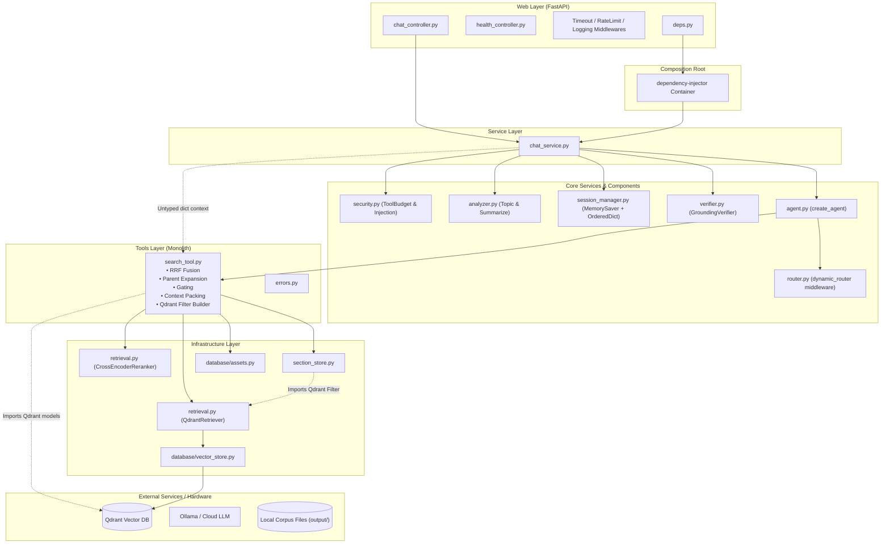
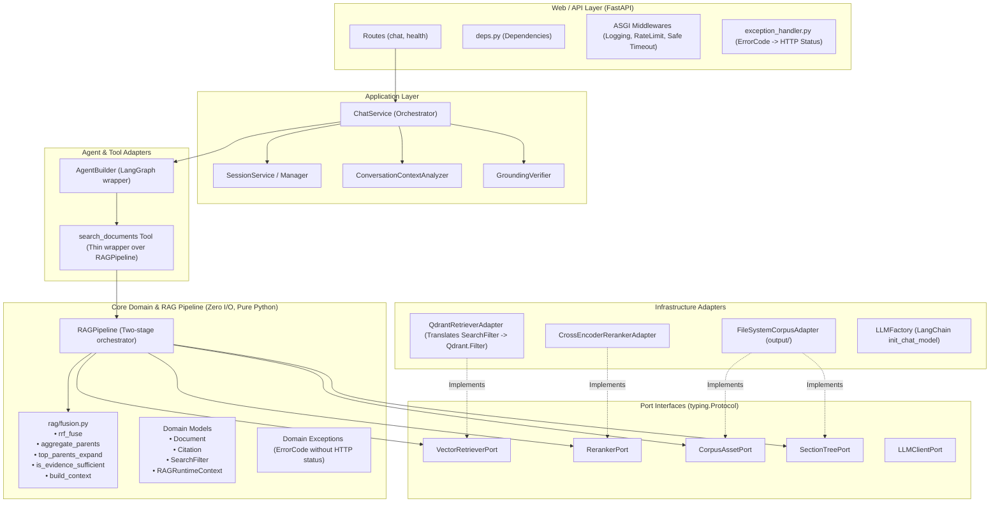

# Architecture Review & Refactoring Plan

**Project:** AI-Service (Production RAG Chatbot API)  
**Author:** Senior Software Architect & Backend Engineer  
**Date:** October 2026  
**Status:** PROPOSED (Review & Approval Required Before Implementation)

---

## Table of Contents
1. [A. Executive Summary](#a-executive-summary)
2. [B. Findings With Evidence](#b-findings-with-evidence)
   - [Architectural & Concurrency Flaws](#architectural--concurrency-flaws)
   - [SOLID Violations](#solid-violations)
   - [Code Duplication & Dead Code](#code-duplication--dead-code)
   - [Packaging, Naming & Organization Flaws](#packaging-naming--organization-flaws)
3. [C. Provider Replacement Impact Matrix](#c-provider-replacement-impact-matrix)
4. [D. Current vs Proposed Architecture](#d-current-vs-proposed-architecture)
   - [Current Architecture (As Implemented)](#current-architecture-as-implemented)
   - [Proposed Clean Architecture](#proposed-clean-architecture)
   - [Current vs Proposed Directory Tree](#current-vs-proposed-directory-tree)
   - [Structural Change Rationale](#structural-change-rationale)
5. [E. Refactoring Roadmap](#e-refactoring-roadmap)
   - [Phase 0 — Safety & Test Harness Stabilization](#phase-0--safety--test-harness-stabilization)
   - [Phase 1 — Dead Code, Duplication & Structural Cleanup](#phase-1--dead-code-duplication--structural-cleanup)
   - [Phase 2 — SOLID Boundaries & Decoupling RAG Pipeline](#phase-2--solid-boundaries--decoupling-rag-pipeline)
   - [Phase 3 — Provider Abstractions & Replaceability Adapters](#phase-3--provider-abstractions--replaceability-adapters)
   - [Phase 4 — Comprehensive Verification & Benchmarking](#phase-4--comprehensive-verification--benchmarking)
6. [F. Prioritized Action Items](#f-prioritized-action-items)

---

## A. Executive Summary

### 1. Overall Architecture Assessment
The codebase implements an advanced, high-quality Retrieval-Augmented Generation (RAG) backend utilizing FastAPI, LangChain, LangGraph, Qdrant Hybrid Search (Dense + BM25 Sparse), Reciprocal Rank Fusion (RRF), Hierarchical Section Tree expansion, CrossEncoder reranking, and Grounding verification.

The retrieval logic itself is sophisticated and demonstrates strong domain knowledge in RAG systems (e.g. early-exit gating to avoid unnecessary HyDE expansions, parent/section chunk expansion, citation extraction, and anti-hallucination evaluation).

However, from an **enterprise software engineering and architectural maintainability** perspective, the codebase suffers from severe architectural coupling, abstraction leakage, concurrency deadlocks in test runners, dead code, and out-of-sync documentation.

### 2. Main Maintainability Problems
1. **Critical Concurrency Deadlock in Middleware (`TimeoutMiddleware`):**
   `TimeoutMiddleware` uses Starlette `BaseHTTPMiddleware` and wraps `call_next(request)` in `asyncio.wait_for`. In ASGI test environments (`TestClient`), this causes an event-loop deadlock between worker threads and the anyio loop, causing API test suites (`tests/test_chat_api.py`) to hang indefinitely.
2. **Severe Abstraction Leakage of Qdrant:**
   Qdrant-specific data models (`models.Filter`, `models.FieldCondition`, `models.MatchValue`, `models.FusionQuery`) leak through `src/tools/search_tool.py`, `src/infra/section_store.py`, and `src/infra/retrieval.py`. Replacing Qdrant with Milvus, Weaviate, or pgvector requires modifying multiple core and tool files.
3. **Monolithic God Module in `src/tools/search_tool.py` (291 lines):**
   Combines LangChain tool registration, input validation, Qdrant filter building, search caching, tool budget consumption, direct vector retrieval, parent aggregation, section tree depth calculation, hierarchical expansion, CrossEncoder reranking, early-exit gating, HyDE multi-query expansion, RRF rank fusion, and context string formatting.
4. **Untyped Dictionary Bag (`ctx`) Pattern:**
   Business dependencies (`retriever`, `reranker`, `assets`, `sections`, `weak_model`, `strong_model`, `cfg`, `tool_budget`, `search_cache`, `paraphrase`) are bundled into an untyped dictionary passed via `runtime.context`. This circumvents Python's type system, obscures component dependencies, and complicates testing.
5. **Session Management Dual-State & Private State Mutation:**
   `SessionManager` maintains two parallel state stores: an internal `OrderedDict` history and LangGraph's `MemorySaver`. When resetting a session, it forcibly accesses private attributes of `MemorySaver` (`getattr(self.checkpointer, "storage", None).pop(...)`).
6. **Documentation Drift:**
   `src/README.MD` describes a non-existent architectural structure (`service/ports.py`, `service/rag_service.py`, `service/llm_service.py`, `tests/web/`, `tests/service/`) that has drifted from the actual repository code.

### 3. Major SOLID Violations
- **Single Responsibility Principle (SRP):** `src/tools/search_tool.py` performs 12 distinct responsibilities. `src/service/chat_service.py` mixes security checks, multi-turn analysis, query rewriting, LangGraph orchestration, grounding evaluation, and response mapping.
- **Open/Closed Principle (OCP):** Adding a new vector database or reranker requires editing existing filter builders, retriever signatures, and tool functions.
- **Liskov Substitution Principle (LSP):** `QdrantRetriever.search` expects a parameter explicitly named `qdrant_filter` containing a `qdrant_client.models.Filter`. Replacing it with another retriever violates the substitution contract.
- **Interface Segregation Principle (ISP):** Complete absence of abstract protocols (`typing.Protocol` or `abc.ABC`). Components receive broad untyped context objects.
- **Dependency Inversion Principle (DIP):** High-level services directly instantiate or depend on concrete infrastructure classes and provider-specific types.

### 4. Areas with Excessive Complexity vs Dead Code
- **Over-fragmentation:** Single-file directories with negligible logic (`src/mapper/` with 5 lines, `src/enums/` with 5 lines of unused code, `src/model/domain/` which is empty).
- **Dead Code:** `SearchType` in `src/enums/search_type.py` has 0 references. `safe_dumps` in `src/util/json_util.py` has 0 references.
- **Duplicated code:** Slicing logic duplicated consecutively in `SessionManager.record_turn`.

### 5. Existing Design Decisions to Preserve
- **FastAPI dependency injection via `deps.py`**: Clean entrypoints for routes.
- **Two-tier Model Strategy (Weak vs Strong)**: Cost-effective HyDE expansion and conversation analysis using tier-1 cheap models, reserving tier-2 strong models for final synthesis.
- **Early-exit Gating (`is_evidence_sufficient`)**: Bypasses costly HyDE multi-query retrieval if direct search yields high confidence.
- **Grounding and Citation Verification (`verifier.py`)**: Robust anti-hallucination checking and citation alignment.
- **Section Tree Metadata Resolver (`SectionStore`)**: Resolving hierarchical chapters/sections into subtrees.

---

## B. Findings With Evidence

### Architectural & Concurrency Flaws

#### Finding B.1 [CRITICAL] `TimeoutMiddleware` Causes Deadlock in TestClient & Synchronous Endpoints
- **Severity:** Critical
- **Affected File & Lines:** [src/web/middleware/timeout_middleware.py](file:///c:/Users/Admin/Desktop/RAG/src/web/middleware/timeout_middleware.py#L25-L35)
- **Current Implementation:**
  ```python
  class TimeoutMiddleware(BaseHTTPMiddleware):
      ...
      async def dispatch(self, request: Request, call_next):
          if request.url.path.startswith(("/health", "/docs", "/openapi.json")):
              return await call_next(request)
          try:
              return await asyncio.wait_for(call_next(request), timeout=float(self.timeout_seconds))
          except asyncio.TimeoutError:
              ...
  ```
- **Why it is problematic:**
  Starlette's `BaseHTTPMiddleware` wraps request processing in a background task streaming the response. Wrapping `call_next(request)` inside `asyncio.wait_for(...)` causes deadlocks when run under Starlette's synchronous `TestClient` (which uses AnyIO thread synchronization). In tests, `TestClient` waits for the response while the middleware waits for the stream body, hanging the entire test suite indefinitely (`tests/test_chat_api.py` hangs on the first test). In production, `BaseHTTPMiddleware` also prevents response streaming and loses context variables.
- **Recommended Improvement:**
  Replace `BaseHTTPMiddleware` with pure ASGI middleware or apply request timeouts at the application/agent level (or using an async timeout context within asynchronous route handlers) rather than wrapping ASGI streaming responses in `asyncio.wait_for`.
- **Expected Benefits:**
  Test suite runs in under 2 seconds without hanging; prevents production event-loop thread contention and memory leaks.
- **Risks & Trade-offs:** None.

---

### SOLID Violations

#### Finding B.2 [HIGH] God-Module and Multiple Responsibilities in `search_tool.py` (SRP Violation)
- **Severity:** High
- **Affected File & Lines:** [src/tools/search_tool.py](file:///c:/Users/Admin/Desktop/RAG/src/tools/search_tool.py#L25-L291)
- **Current Implementation:**
  A single file contains:
  - Lines 25–35: Reciprocal Rank Fusion (`rrf_fuse`)
  - Lines 47–61: Parent grouping and aggregation (`aggregate_parents`)
  - Lines 63–75: Hierarchical child chunk expansion (`top_parents_expand`)
  - Lines 78–84: Context prompt generation (`build_context`)
  - Lines 95–107: Hierarchy depth calculation (`depth_of`)
  - Lines 109–119: Confidence threshold gating (`is_evidence_sufficient`)
  - Lines 147–171: Qdrant filter generation (`_metadata_conditions`, `_resolve_filter`)
  - Lines 173–194: Citation metadata enrichment and packing (`_pack`)
  - Lines 196–269: Two-stage retrieval execution pipeline (`_search_impl`)
  - Lines 271–291: LangChain tool schema declaration (`search_documents`)
- **Why it is problematic:**
  Pure domain algorithms (RRF, parent aggregation, gating) are tightly coupled with external LangChain tool decorators and Qdrant filter objects. Testing pure logic requires importing heavy ML and LangChain dependencies. Modifying retrieval logic risks breaking the LangChain tool interface.
- **Recommended Improvement:**
  Split into cohesive modules:
  1. `core/rag/fusion.py`: Pure algorithmic functions (`rrf_fuse`, `aggregate_parents`, `top_parents_expand`, `is_evidence_sufficient`).
  2. `core/rag/pipeline.py`: Pure pipeline orchestrator (`RAGRetrieverPipeline`).
  3. `tools/search_tool.py`: Thin LangChain adapter that delegates to the pipeline.
- **Expected Benefits:**
  Algorithms can be unit-tested in isolation in milliseconds without mocking LangChain or Qdrant. Code is readable and maintainable.
- **Risks & Trade-offs:**
  Need to update imports in tests (`tests/test_output_format.py`).

#### Finding B.3 [HIGH] Qdrant API and Data Model Leaking Across Layers (DIP & OCP Violation)
- **Severity:** High
- **Affected Files & Lines:**
  - [src/tools/search_tool.py](file:///c:/Users/Admin/Desktop/RAG/src/tools/search_tool.py#L148-L170): `from qdrant_client import models` used to build `models.Filter`, `models.FieldCondition`, `models.MatchValue`.
  - [src/infra/section_store.py](file:///c:/Users/Admin/Desktop/RAG/src/infra/section_store.py#L48-L52): `subtree_filter` delegates to `build_ancestor_filter` returning a `qdrant_client.models.Filter`.
  - [src/infra/retrieval.py](file:///c:/Users/Admin/Desktop/RAG/src/infra/retrieval.py#L4-L23): `hybrid_search` hardcoded to `models.FusionQuery(fusion=models.Fusion.DBSF)`.
  - [src/infra/retrieval.py](file:///c:/Users/Admin/Desktop/RAG/src/infra/retrieval.py#L31): Parameter explicitly named `qdrant_filter`.
- **Current Implementation:**
  High-level modules construct and pass concrete Qdrant SDK objects down the call stack.
- **Why it is problematic:**
  Impossible to switch to another vector database (e.g. pgvector, Milvus, Weaviate) or test retrieval without installing and configuring Qdrant data structures. Violates Dependency Inversion Principle (DIP) and Open/Closed Principle (OCP).
- **Recommended Improvement:**
  Define a provider-agnostic filter specification:
  ```python
  @dataclass(frozen=True)
  class SearchFilter:
      section_id: str | None = None
      ancestor_id: str | None = None
      metadata: dict[str, Any] = field(default_factory=dict)
  ```
  The `QdrantRetriever` adapter translates `SearchFilter` into `qdrant_client.models.Filter` internally. `SectionStore` and `search_tool` only speak `SearchFilter`.
- **Expected Benefits:**
  Zero Qdrant imports outside `infra/retrieval.py` and `core/database/vector_store.py`. Pluggable vector backends.
- **Risks & Trade-offs:**
  Small mapping step in the Qdrant adapter.

#### Finding B.4 [MEDIUM] Domain Error Codes Coupled to HTTP Status Codes (SRP & Layering Violation)
- **Severity:** Medium
- **Affected File & Lines:** [src/core/exception/errors.py](file:///c:/Users/Admin/Desktop/RAG/src/core/exception/errors.py#L5-L25)
- **Current Implementation:**
  ```python
  class ErrorCode(Enum):
      NOT_FOUND = (404, "data not found")
      AGENT_TIMEOUT = (504, "agent timed out")
      AGENT_FAILED = (500, "agent failed")
      RATE_LIMITED = (429, "Too many requests. Please slow down.")
      ...
  ```
- **Why it is problematic:**
  Core/domain exception types directly encapsulate HTTP transport details (`status_code`). If the core service is consumed by a message queue worker, CLI, or gRPC endpoint, HTTP status codes are irrelevant and violate clean architecture boundaries.
- **Recommended Improvement:**
  Keep `ErrorCode` clean as symbolic business domain errors (e.g., `NOT_FOUND = "NOT_FOUND"`). Let the web layer exception handler (`src/web/middleware/exception_handler.py`) map domain `ErrorCode` to HTTP status codes.
- **Expected Benefits:**
  Decouples core business logic from HTTP transport.
- **Risks & Trade-offs:**
  Need to update `app_error_handler` mapping table.

#### Finding B.5 [MEDIUM] Untyped Context Dict Bag (`ctx`) in Agent Runtime (ISP Violation)
- **Severity:** Medium
- **Affected Files & Lines:**
  - [src/service/chat_service.py](file:///c:/Users/Admin/Desktop/RAG/src/service/chat_service.py#L130-L140)
  - [src/core/agent.py](file:///c:/Users/Admin/Desktop/RAG/src/core/agent.py#L22-L35)
  - [src/tools/search_tool.py](file:///c:/Users/Admin/Desktop/RAG/src/tools/search_tool.py#L203-L225)
- **Current Implementation:**
  `ctx = {**self.ctx, "role": body.role, "search_cache": {}, "paraphrase": self.paraphrase, ...}`.
  In `_search_impl`: `retriever = ctx["retriever"]`, `reranker = ctx["reranker"]`, `cfg = ctx["cfg"]`.
- **Why it is problematic:**
  Untyped string dictionary keys mean typos cause runtime `KeyError`s during user requests rather than static type check errors. IDE autocompletion is impossible, and callers cannot know what dependencies the tool requires without reading internal tool code.
- **Recommended Improvement:**
  Define a strongly-typed `RAGRuntimeContext` dataclass or pass dependencies directly into an encapsulated `RAGPipeline` class instance.
- **Expected Benefits:**
  Full static type checking with `mypy`/`pyright`, autocomplete, zero dictionary lookups.
- **Risks & Trade-offs:** None.

---

### Code Duplication & Dead Code

#### Finding B.6 [LOW] Identical Duplicated Slicing in `SessionManager` (DRY Violation)
- **Severity:** Low
- **Affected File & Lines:** [src/core/session/session_manager.py](file:///c:/Users/Admin/Desktop/RAG/src/core/session/session_manager.py#L91-L96)
- **Current Implementation:**
  ```python
  # Giữ số lượt vừa phải trong RAM
  if len(self._history[session_id]) > self.max_history_turns * 2:
      self._history[session_id] = self._history[session_id][-self.max_history_turns * 2 :]

  self._cleanup()
  if len(self._history[session_id]) > self.max_history_turns * 2:
      self._history[session_id] = self._history[session_id][-self.max_history_turns * 2 :]
  ```
- **Why it is problematic:**
  The exact same 2 lines of slicing code are executed back-to-back before and after `_cleanup()`.
- **Recommended Improvement:**
  Remove the redundant duplicate if-statement block.
- **Expected Benefits:**
  Cleaner code, less confusion.
- **Risks & Trade-offs:** None.

#### Finding B.7 [LOW] Violation of Encapsulation on LangGraph `MemorySaver`
- **Severity:** Low
- **Affected File & Lines:** [src/core/session/session_manager.py](file:///c:/Users/Admin/Desktop/RAG/src/core/session/session_manager.py#L105-L110)
- **Current Implementation:**
  ```python
  # Xóa checkpoint LangGraph nếu có
  try:
      storage = getattr(self.checkpointer, "storage", None)
      if storage is not None and session_id in storage:
          storage.pop(session_id, None)
  except Exception:
      pass
  ```
- **Why it is problematic:**
  Directly accesses and mutates private internals (`.storage`) of LangGraph's `MemorySaver`. If LangGraph changes internal data structures or if `SqliteSaver`/`PostgresSaver` is used, this silently fails or does nothing.
- **Recommended Improvement:**
  Encapsulate checkpoint eviction behind a checkpointer adapter interface or rely on LangGraph's standard checkpoint management.
- **Expected Benefits:**
  Prevents runtime breakage when upgrading LangGraph.
- **Risks & Trade-offs:** None.

#### Finding B.8 [LOW] Dead Code Modules and Empty Packages
- **Severity:** Low
- **Affected Files:**
  - [src/enums/search_type.py](file:///c:/Users/Admin/Desktop/RAG/src/enums/search_type.py): `SearchType.HYBRID_DBSF` defined in its own directory, never referenced anywhere in codebase.
  - [src/util/json_util.py](file:///c:/Users/Admin/Desktop/RAG/src/util/json_util.py): `safe_dumps` defined, 0 usages.
  - [src/model/domain/__init__.py](file:///c:/Users/Admin/Desktop/RAG/src/model/domain/__init__.py): Empty folder.
  - [src/mapper/chat_mapper.py](file:///c:/Users/Admin/Desktop/RAG/src/mapper/chat_mapper.py): 5 lines containing `to_response(result: dict) -> ChatQueryResponse: return ChatQueryResponse(**result)`.
- **Why it is problematic:**
  Creates folder bloat and cognitive friction for developers navigating the project.
- **Recommended Improvement:**
  - Delete `src/enums/search_type.py` and `src/util/json_util.py`.
  - Remove empty `src/model/domain/` directory.
  - Inline or move `to_response` into `ChatQueryResponse.from_result(...)` in `src/model/res/chat_res.py` and eliminate `src/mapper/`.
- **Expected Benefits:**
  Eliminates 3 redundant top-level packages (`enums/`, `mapper/`, `model/domain/`).
- **Risks & Trade-offs:** None.

---

### Packaging, Naming & Organization Flaws

#### Finding B.9 [MEDIUM] Misplaced Files & Unintuitive Folder Semantics
- **Severity:** Medium
- **Affected Files:**
  - [src/core/database/assets.py](file:///c:/Users/Admin/Desktop/RAG/src/core/database/assets.py): Named "database", but it loads CSV and JSON metadata files directly from the local `output/` directory on disk.
  - [src/infra/section_store.py](file:///c:/Users/Admin/Desktop/RAG/src/infra/section_store.py): Placed in `infra/` while `assets.py` is in `core/database/`, yet both are local document corpus metadata loaders for the RAG pipeline.
  - [src/model/req/chat_req.py](file:///c:/Users/Admin/Desktop/RAG/src/model/req/chat_req.py) & [src/model/res/chat_res.py](file:///c:/Users/Admin/Desktop/RAG/src/model/res/chat_res.py): Over-fragmented directory hierarchy (`model/req` and `model/res`) for just two files.
- **Why it is problematic:**
  Violates standard Python project conventions where DTOs and corpus loaders should be logically grouped.
- **Recommended Improvement:**
  - Group document metadata and asset loaders together under `infra/storage/` or `core/corpus/`.
  - Group request and response schemas in `model/schemas.py` or keep `model/chat.py`.
- **Expected Benefits:**
  Immediate clarity on what interacts with external systems vs local files.
- **Risks & Trade-offs:** Update import statements.

#### Finding B.10 [LOW] Outdated and Misleading Documentation in `src/README.MD`
- **Severity:** Low
- **Affected File & Lines:** [src/README.MD](file:///c:/Users/Admin/Desktop/RAG/src/README.MD#L16-L45)
- **Current Implementation:**
  Documents non-existent files: `service/ports.py`, `service/rag_service.py`, `service/llm_service.py`, `tests/web/`, `tests/service/`.
- **Why it is problematic:**
  Misleads new engineers and automated agents about the actual architecture.
- **Recommended Improvement:**
  Update `README.MD` to accurately reflect the real directory structure, dependencies, and testing commands.
- **Expected Benefits:**
  Accurate developer onboarding and system comprehension.
- **Risks & Trade-offs:** None.

---

## C. Provider Replacement Impact Matrix

| Component | Current Coupling | Files Affected | Replacement Difficulty | Recommended Change |
|---|---|---|---|---|
| **Vector DB**<br>*(Qdrant → Milvus / Weaviate / pgvector)* | **High**<br>Qdrant client, models, and filter classes leak into tools, stores, and retrievers. | • `src/core/database/vector_store.py`<br>• `src/infra/retrieval.py`<br>• `src/infra/section_store.py`<br>• `src/tools/search_tool.py`<br>• `src/config/settings.py`<br>• `src/core/container.py` | **High** | Introduce an abstract `BaseRetriever` protocol and a generic `SearchFilter` dataclass. Encapsulate Qdrant-specific `models.Filter` and hybrid search completely inside `QdrantRetriever`. |
| **LLM Provider**<br>*(Ollama → Gemini / OpenAI / Anthropic)* | **Low to Medium**<br>LangChain's `init_chat_model` provides good normalization, but timeout kwargs have provider-specific logic. | • `src/core/models/chat_model.py`<br>• `src/config/settings.py`<br>• `src/core/container.py` | **Low** | Encapsulate provider-specific client kwargs inside a clean factory map. The rest of the codebase interacts only with `BaseChatModel`. |
| **Embedding**<br>*(Ollama Qwen3 → FastEmbed / OpenAI / HuggingFace)* | **Medium**<br>Tied to Qdrant's dual dense/sparse collection setup (`FastEmbedSparse`). | • `src/core/models/embeddings.py`<br>• `src/core/database/vector_store.py`<br>• `src/config/settings.py` | **Medium** | Keep embedding factory clean. If replacing sparse embeddings, adjust `VectorStore` sparse indexing settings via configuration. |
| **Reranker**<br>*(CrossEncoder → Cohere / BGE / ColBERT)* | **Medium**<br>Direct call to `sentence_transformers.CrossEncoder.predict()`. | • `src/core/models/reranker.py`<br>• `src/infra/retrieval.py`<br>• `src/tools/search_tool.py` | **Low to Medium** | Introduce a `BaseReranker` protocol: `def rerank(self, query: str, docs: list[Document]) -> list[tuple[Document, float]]: ...`. Allow pluggable reranker implementations. |
| **Session Storage**<br>*(In-Memory → Redis / PostgreSQL / MongoDB)* | **Medium**<br>`SessionManager` mixes in-memory `OrderedDict` with LangGraph `MemorySaver` and touches `.storage` private member. | • `src/core/session/session_manager.py`<br>• `src/service/chat_service.py`<br>• `src/core/container.py` | **Medium** | Define a clean `SessionStore` protocol with `get_history`, `record_turn`, `reset_session`. Separate LangGraph checkpointing configuration from user conversation history. |

---

## D. Current vs Proposed Architecture

### Current Architecture (As Implemented)



---

### Proposed Clean Architecture



---

### Current vs Proposed Directory Tree

#### Current Directory Tree
```
src/
├── .env.example
├── main.py
├── README.MD
├── config/
│   ├── __init__.py
│   ├── prompts.py
│   └── settings.py
├── core/
│   ├── __init__.py
│   ├── agent.py
│   ├── container.py
│   ├── router.py
│   ├── security.py
│   ├── database/
│   │   ├── __init__.py
│   │   ├── assets.py
│   │   └── vector_store.py
│   ├── exception/
│   │   ├── __init__.py
│   │   └── errors.py
│   ├── grounding/
│   │   ├── __init__.py
│   │   └── verifier.py
│   ├── models/
│   │   ├── __init__.py
│   │   ├── chat_model.py
│   │   ├── embeddings.py
│   │   └── reranker.py
│   └── session/
│       ├── __init__.py
│       ├── analyzer.py
│       └── session_manager.py
├── enums/                      <-- [DEAD CODE: 1 unused enum]
│   ├── __init__.py
│   └── search_type.py
├── infra/
│   ├── __init__.py
│   ├── retrieval.py
│   └── section_store.py
├── mapper/                     <-- [REDUNDANT: 5-line 1-method file]
│   ├── __init__.py
│   └── chat_mapper.py
├── model/
│   ├── __init__.py
│   ├── domain/                 <-- [EMPTY DIRECTORY]
│   │   └── __init__.py
│   ├── req/                    <-- [OVER-FRAGMENTED]
│   │   ├── __init__.py
│   │   └── chat_req.py
│   └── res/                    <-- [OVER-FRAGMENTED]
│       ├── __init__.py
│       └── chat_res.py
├── service/
│   ├── __init__.py
│   └── chat_service.py
├── tools/
│   ├── __init__.py
│   ├── errors.py
│   └── search_tool.py          <-- [GOD MODULE: 291 lines]
├── util/
│   ├── __init__.py
│   ├── json_util.py            <-- [DEAD CODE: 0 usages]
│   └── string_util.py
└── web/
    ├── __init__.py
    ├── deps.py
    ├── controller/
    │   ├── __init__.py
    │   ├── chat_controller.py
    │   └── health_controller.py
    └── middleware/
        ├── __init__.py
        ├── exception_handler.py
        ├── logging_middleware.py
        ├── rate_limit_middleware.py
        └── timeout_middleware.py <-- [DEADLOCK BUG]
```

#### Proposed Directory Tree
```
src/
├── .env.example
├── main.py
├── README.md                   # Updated, accurate documentation
├── config/
│   ├── __init__.py
│   ├── prompts.py
│   └── settings.py
├── core/
│   ├── __init__.py
│   ├── container.py            # Typed Composition Root
│   ├── security.py             # Tool budget & prompt injection guards
│   ├── errors.py               # Clean domain exceptions & error codes
│   ├── rag/                    # Pure Domain RAG logic (No I/O, No Qdrant)
│   │   ├── __init__.py
│   │   ├── fusion.py           # rrf_fuse, aggregate_parents, top_parents_expand, gating
│   │   ├── context_builder.py  # build_context, section_label, depth_of
│   │   ├── pipeline.py         # RAGPipeline (two-stage retrieval orchestrator)
│   │   └── types.py            # SearchFilter, RetrievalResult, RAGRuntimeContext
│   ├── agent/
│   │   ├── __init__.py
│   │   ├── factory.py          # create_agent
│   │   └── router.py           # dynamic_router & is_simple
│   ├── grounding/
│   │   ├── __init__.py
│   │   └── verifier.py         # GroundingVerifier
│   └── session/
│       ├── __init__.py
│       ├── analyzer.py         # ConversationAnalyzer
│       └── session_manager.py  # Cleaned SessionManager (no duplicated code)
├── infra/
│   ├── __init__.py
│   ├── corpus/                 # Local filesystem corpus adapters
│   │   ├── __init__.py
│   │   ├── asset_service.py    # Assets & images from output/ (formerly database/assets.py)
│   │   └── section_store.py    # Section tree resolver from output/
│   ├── providers/              # External model & DB adapters
│   │   ├── __init__.py
│   │   ├── qdrant_retriever.py # Qdrant client & adapter (only place importing qdrant_client)
│   │   ├── reranker.py         # CrossEncoder reranker adapter
│   │   ├── chat_models.py      # LLM factory
│   │   └── embeddings.py       # Embedding factory
├── model/                      # Clean Request/Response schemas
│   ├── __init__.py
│   ├── chat_req.py             # ChatQueryRequest
│   └── chat_res.py             # ChatQueryResponse, Citation, TableRef, ImageRef
├── service/
│   ├── __init__.py
│   └── chat_service.py         # Application service orchestrator
├── tools/
│   ├── __init__.py
│   ├── errors.py               # handle_tool_errors
│   └── search_tool.py          # Thin LangChain @tool adapter calling core/rag/pipeline.py
├── util/
│   ├── __init__.py
│   └── string_util.py          # normalize_ws, dedupe_paraphrases
└── web/
    ├── __init__.py
    ├── deps.py                 # FastAPI Depends entrypoints
    ├── controller/
    │   ├── __init__.py
    │   ├── chat_controller.py
    │   └── health_controller.py
    └── middleware/
        ├── __init__.py
        ├── exception_handler.py # Maps domain ErrorCode to HTTP status
        ├── logging_middleware.py
        ├── rate_limit_middleware.py
        └── timeout_middleware.py # Fixed, non-blocking timeout handler
```

---

### Structural Change Rationale
1. **Consolidate `core/rag/`:**
   Extracts 180 lines of pure algorithms from `tools/search_tool.py` into dedicated pure Python files (`fusion.py`, `context_builder.py`, `pipeline.py`).
   *Benefit:* Makes the core RAG algorithms testable without LangChain, MockAgent, or Qdrant.
2. **Move `core/database/assets.py` to `infra/corpus/asset_service.py`:**
   `assets.py` reads JSON, CSV, and PNG files from `output/`. Calling it "database" was a semantic mismatch. Grouping it with `section_store.py` in `infra/corpus/` groups all local document corpus interactions together.
3. **Isolate Qdrant to `infra/providers/qdrant_retriever.py`:**
   All `qdrant_client` imports are strictly confined to this adapter file. Core RAG modules only deal with `SearchFilter` and standard `Document` objects.
4. **Delete Dead & Redundant Folders (`src/enums/`, `src/mapper/`, `src/model/domain/`):**
   Removes zero-value indirection and reduces file clutter.
5. **Flatten `src/model/req/` and `src/model/res/` into `src/model/`:**
   Reduces deep, unnecessary directory hierarchies for just 2 schema files.

---

## E. Refactoring Roadmap

### Phase 0 — Safety & Test Harness Stabilization
*Goal: Fix test runner hanging so the regression harness runs cleanly in CI/CD before any architectural changes.*

- **Files to Modify:**
  - `src/web/middleware/timeout_middleware.py`: Fix Starlette `BaseHTTPMiddleware` concurrency deadlock. Either make it pure ASGI or guard against `TestClient` / allow passing `asyncio.timeout` without blocking response streaming.
  - `tests/test_chat_api.py`: Verify that all 3 API tests pass reliably in < 1s.
- **Dependencies:** None.
- **Expected Risks:** Low. Middleware behavior must match existing status 504 on timeout.
- **Acceptance Criteria:**
  - `python -m pytest tests/test_chat_api.py` completes in < 2 seconds with 3 passed tests.
  - Full test suite passes: `python -m pytest` passes all 44 tests.
- **Verification Steps:**
  ```powershell
  python -m pytest tests/test_chat_api.py -vv
  python -m pytest tests -vv
  ```

---

### Phase 1 — Quick Wins: Dead Code, Duplication & Structural Cleanup
*Goal: Remove zero-value code, eliminate duplication, and remove empty folders without altering any logic.*

- **Files to Modify / Delete:**
  - Delete `src/enums/search_type.py` and remove `src/enums/`.
  - Delete `src/util/json_util.py`.
  - Delete empty `src/model/domain/` folder.
  - Move `to_response` into `src/model/res/chat_res.py` as a classmethod `ChatQueryResponse.from_dict(...)` and delete `src/mapper/`.
  - Flatten `src/model/req/chat_req.py` and `src/model/res/chat_res.py` to `src/model/chat_req.py` and `src/model/chat_res.py`.
  - Fix duplicate code in `src/core/session/session_manager.py` (lines 91-96).
  - Update `src/README.MD` to accurately reflect codebase reality.
- **Dependencies:** Completion of Phase 0.
- **Expected Risks:** Import path changes in files that imported `model.req` or `model.res`.
- **Acceptance Criteria:**
  - Zero dead code files remaining.
  - Clean test run with all 44 tests passing.
- **Verification Steps:**
  ```powershell
  python -m pytest tests
  ```

---

### Phase 2 — Architecture Improvements: Pure RAG Decoupling & Typed Context
*Goal: Break the God module `src/tools/search_tool.py`, extract pure algorithms, and introduce strongly-typed context.*

- **Files to Modify / Create:**
  - Create `src/core/rag/types.py`: `SearchFilter`, `RAGRuntimeContext`, `RetrievalCandidate`.
  - Create `src/core/rag/fusion.py`: Extract `rrf_fuse`, `aggregate_parents`, `top_parents_expand`, `is_evidence_sufficient`.
  - Create `src/core/rag/context_builder.py`: Extract `build_context`, `section_label`, `depth_of`.
  - Create `src/core/rag/pipeline.py`: Encapsulate `RAGPipeline` with two-stage execution (`run_direct_stage`, `run_hyde_stage`).
  - Refactor `src/tools/search_tool.py`: Becomes a clean ~40 line LangChain tool delegating to `RAGPipeline`.
  - Add unit tests in `tests/test_rag_fusion.py`: Directly test `rrf_fuse`, `aggregate_parents`, and gating with simple dataclasts (0 mocks, 0 network, runs in 10ms).
- **Dependencies:** Completion of Phase 1.
- **Expected Risks:** Changes to function signatures in `search_tool.py` if tests were importing private functions like `_pack`.
- **Acceptance Criteria:**
  - `src/tools/search_tool.py` contains only tool schema and delegation.
  - All existing citation, BOM, depth, and output formatting tests pass without modification.
  - `tests/test_rag_fusion.py` provides 100% branch coverage on fusion and gating.
- **Verification Steps:**
  ```powershell
  python -m pytest tests/test_output_format.py -vv
  python -m pytest tests/test_chat_service.py -vv
  ```

---

### Phase 3 — Provider Replaceability & Decoupled Adapters
*Goal: Isolate vector store, reranker, and session store behind provider-agnostic interfaces.*

- **Files to Modify / Create:**
  - Create `src/core/rag/interfaces.py`: Define `VectorRetrieverPort` and `RerankerPort` using `typing.Protocol`.
  - Refactor `src/infra/retrieval.py` -> `src/infra/providers/qdrant_retriever.py`:
    - Move `build_ancestor_filter` inside `QdrantRetriever`.
    - Accept generic `SearchFilter(section_id=..., metadata=...)` instead of `models.Filter`.
    - Map `SearchFilter` to `qdrant_client.models.Filter` internally inside `QdrantRetriever`.
  - Refactor `src/infra/section_store.py`:
    - Remove `from infra.retrieval import build_ancestor_filter`.
    - Return `SearchFilter(ancestor_id=node_id)` instead of a Qdrant filter object.
  - Decouple `src/core/exception/errors.py`:
    - Remove HTTP status codes from `ErrorCode` enum values.
    - Map `ErrorCode` to HTTP status codes inside `src/web/middleware/exception_handler.py`.
- **Dependencies:** Completion of Phase 2.
- **Expected Risks:** Ensuring Qdrant queries generated from `SearchFilter` produce identical query vectors and filters as before.
- **Acceptance Criteria:**
  - Zero imports of `qdrant_client` anywhere in `src/core/`, `src/tools/`, or `src/service/`.
  - All Qdrant-specific constructs isolated to `src/infra/providers/`.
- **Verification Steps:**
  ```powershell
  python -m pytest tests -vv
  ```

---

### Phase 4 — Validation & Regression Verification
*Goal: Verify end-to-end functionality, API contracts, RAG answer quality, and absence of regressions.*

- **Tasks:**
  - Run full automated test suite.
  - Verify OpenAPI / Swagger documentation schema contracts (`GET /openapi.json`).
  - Run benchmark queries with mock and live models (if available) to ensure retrieval quality, citation format, and response timing remain unaffected.
  - Verify container startup, warmup timing, and resource closure.
- **Acceptance Criteria:**
  - 100% tests passing.
  - Response contract matches `ChatQueryResponse` schema byte-for-byte.
  - Zero performance regression.

---

## F. Prioritized Action Items

Recommendations ranked by impact, risk reduction, implementation effort, and provider replaceability:

| Priority | Category | Action Item | Impact | Risk | Effort | Target |
|:---:|:---:|---|:---:|:---:|:---:|:---:|
| **1** | **Must Fix** | **Fix `TimeoutMiddleware` deadlock with `TestClient`** | Very High | Very Low | Low | Phase 0 |
| **2** | **Must Fix** | **Extract pure algorithms from `search_tool.py` into `core/rag/`** | Very High | Low | Medium | Phase 2 |
| **3** | **Must Fix** | **Decouple Qdrant filter generation from `search_tool.py` and `section_store.py` via `SearchFilter`** | Very High | Low | Medium | Phase 3 |
| **4** | **Should Improve** | **Remove dead code (`SearchType`, `safe_dumps`, empty `domain/`, redundant `mapper/`)** | Medium | Very Low | Low | Phase 1 |
| **5** | **Should Improve** | **Fix consecutive duplicated slicing lines in `SessionManager.record_turn`** | Low | Very Low | Low | Phase 1 |
| **6** | **Should Improve** | **Replace untyped `ctx` dict with typed `RAGRuntimeContext` dataclass** | High | Low | Low | Phase 2 |
| **7** | **Should Improve** | **Decouple HTTP status codes from core domain `ErrorCode`** | Medium | Low | Low | Phase 3 |
| **8** | **Should Improve** | **Rename & relocate `core/database/assets.py` to `infra/corpus/asset_service.py`** | Medium | Low | Low | Phase 1 |
| **9** | **Should Improve** | **Update outdated `src/README.MD`** | Medium | None | Low | Phase 1 |
| **10** | **Optional** | **Abstract LangGraph `MemorySaver` eviction to avoid `.storage` private mutation** | Low | Low | Low | Phase 3 |
| **11** | **Keep As Is** | **Two-Tier LLM Strategy (`weak_model` for HyDE/Classifier, `strong_model` for Generation)** | High | - | - | Core Design |
| **12** | **Keep As Is** | **Early-exit gating (`is_evidence_sufficient`) before HyDE fallback** | High | - | - | Core Design |
| **13** | **Keep As Is** | **Grounding verification and citation alignment (`verifier.py`)** | High | - | - | Core Design |
| **14** | **Keep As Is** | **FastAPI `deps.py` composition root for route dependency injection** | High | - | - | Core Design |

---

## Conclusion & Next Steps

This plan provides a clear, zero-regression roadmap that addresses every SOLID violation, decouples external providers, fixes critical concurrency deadlocks, and simplifies the codebase while preserving all existing retrieval features and performance gains.

**Per instructions: No source code modifications have been made. Awaiting explicit user approval before beginning Phase 0.**

